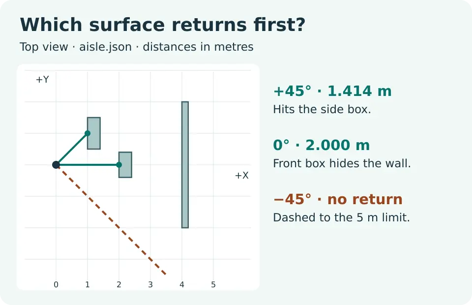
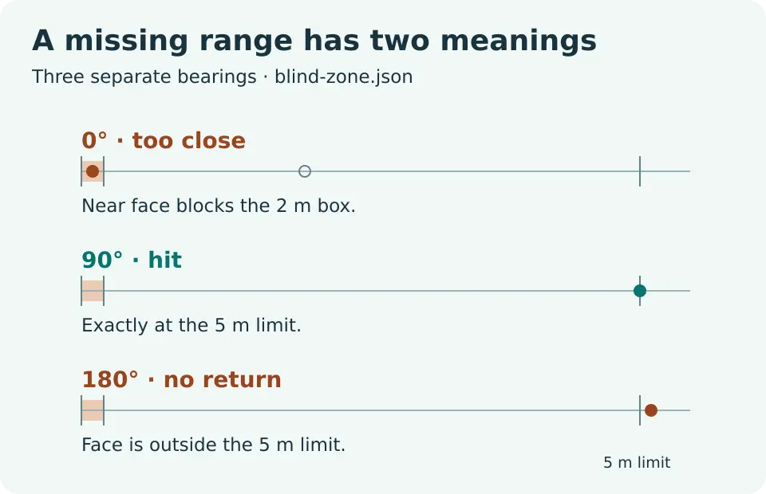

# 2D LiDAR Simulation in Python

Build a planar scan from solid rectangles. See which surface blocks a ray, how sensor yaw changes the view, and why a missing distance does not always mean a clear path.

Full lesson: [2D LiDAR Simulation in Python](https://wifarobotics.com/learn/lidar-simulation-robotics/).

## Start from zero

1. Install [Python 3.11 or newer](https://www.python.org/downloads/). On macOS or Linux, run `python3 --version`. On Windows, try `py -3 --version` in PowerShell and use `py -3` in place of `python3` below.
2. On the project page, choose **Code → Download ZIP**. Extract it. Open a terminal in the extracted folder, the one containing `lidar_scan.py`. No pip installs, hardware, or ROS installation are needed.
3. Run these commands:

```sh
python3 lidar_scan.py examples/aisle.json
python3 lidar_scan.py examples/quarter-turn.json
python3 lidar_scan.py examples/blind-zone.json
python3 -m unittest discover -s tests -v
```

| Scene | Bearings in the sensor frame | Expected results, in scan order |
| --- | --- | --- |
| Aisle | −45°, 0°, 45° | no return; 2 m; about 1.414214 m |
| Quarter turn | −45°, 0°, 45° | about 1.414214 m; no return; no return |
| Blind zone | 0°, 90°, 180°, 270° | too close; 5 m; no return; no return |

The CLI emits one JSON array. Each row has `angle_deg`, `status`, and `range_m`. Non-measurements have `range_m: null`; use `status` to distinguish them. A return at exactly the minimum or maximum is valid in this model.

## Scene format

`pose` is `[x_m, y_m, yaw_deg]` in world coordinates. With zero yaw the sensor looks along world +X; positive yaw turns toward +Y. `angles` is `[first_deg, step_deg]` relative to the sensor. The step is positive, the count is 1 through 1,441, and the first to last beam must span less than 360 degrees to avoid a duplicate end bearing. `limits` is `[minimum_m, maximum_m]`. Each item in `boxes` is `[x_min, y_min, x_max, y_max]` in metres; boxes are solid, include their boundary, and must not contain the sensor.

Try removing the box with a 0.1 m near face in a **copy** of `blind-zone.json`. The forward reading changes from `too_close` to `hit` at 2 m. The program finds the nearest surface first, so it never reveals the hidden box by skipping the blind zone.

## Troubleshooting

* **File not found:** change to the extracted project directory. Use a relative path inside it or quote the full path if it contains spaces.
* **Results turn the wrong way:** `yaw_deg` is counterclockwise in the world; `angle_deg` in the output is relative to the sensor. A world bearing is their sum.
* **Unexpected misses:** check metres versus millimetres, the range limits, and whether any ray intersects a narrow target at your chosen step. Try smaller steps without duplicating the final direction.
* **Sensor rejected:** place the pose outside all rectangles, including their edges. Use four coordinates per box, with strictly increasing bounds.

The tests include hand calculated fixtures, pose translation, exact range limits, invalid inputs, CLI behavior, and a seeded comparison with explicit edge intersections.





The editable SVGs and their generator are in `diagrams/`. Optional regeneration: install Inkscape, ImageMagick with WebP support, and DejaVu Sans, then run `python3 diagrams/render.py`. The scan and tests need none of these tools.

## What the simulator cannot tell you

This is a stationary, noiseless geometry model, not a ROS publisher or a LiDAR driver. It ignores motion during a scan, beam width, material, reflections, multipath, and the device's return policy. It is not a safety sensor or a collision avoidance system. For real data, verify the driver's frame, timing and invalid-value conventions; do not treat a missing return as a safety guarantee.

References: [ROS 2 LaserScan message](https://github.com/ros2/common_interfaces/blob/rolling/sensor_msgs/msg/LaserScan.msg), [ROS REP 117](https://github.com/ros-infrastructure/rep/blob/master/rep-0117.rst), and [PBRT ray and box intersections](https://pbr-book.org/4ed/Shapes/Basic_Shape_Interface#RayBoundsIntersections).
